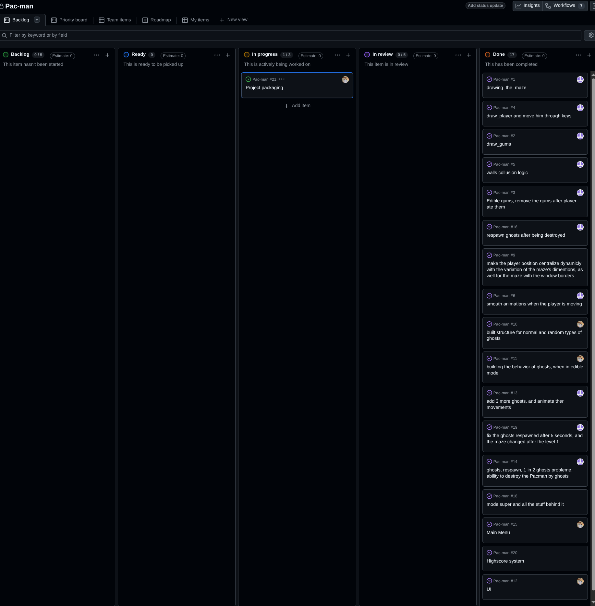

# Pac-Man — Project Management & Development Evidence

**Team:** Two developers (`atchioue` and `ymouafak`, as shown in the Git history)  
**Period covered by supplied records:** 26 September – 13 October 2026  
**Method:** Lightweight Kanban using GitHub Projects, with Git commits documenting implementation  
**Evidence snapshot:** 13 October 2026

> **Evidence policy.** This report is based on the supplied GitHub Projects screenshot and Git commit log. A completed task card or commit is evidence of work, **not** proof that every acceptance test passed. Dates, original deadlines, formal reviews, and test results are not invented when they are absent from the records.

## 1. Project overview and tools

The project is a Pac-Man-style game featuring a generated maze, player movement, collectible gums, ghosts, a super mode, level progression, menus, a highscore system, and a distributable application build.

We organized development using:

- **GitHub Projects:** Kanban board for tasks, assignments, and review status.
- **Git / GitHub commits:** history of implementations, fixes, integration, and changes.
- **Project source repository:** implementation, Makefile, packaging configuration, and other project deliverables.

**Project board URL:** [Project board](https://github.com/users/younes-mfk/projects/1)

**Repository URL:** [Repo](https://github.com/younes-mfk/Pac-man)

### Kanban evidence



In the supplied board snapshot, **17 cards** appear in **Done** and **one card**, **#21 — Project packaging**, appears in **In progress**. No cards are visibly listed under Ready or In review. The board also includes a Backlog column. These counts describe the **snapshot**, not a historical record of every status transition.

Examples of completed board items (issue numbers are those shown in the screenshot):

| Area | Completed cards |
| --- | --- |
| Maze and player | #1 Maze drawing; #2 Gums; #3 Eating gums; #4 Movement; #5 Wall collisions; #6 Smooth animations; #9 Dynamic centering |
| Ghosts and mechanics | #10 Ghost types; #11 Edible behavior; #13 Multiple ghosts; #14 Collisions/respawn; #16 Ghost respawn; #18 Super mode; #19 Level-dependent maze/respawn behavior |
| User interface | #12 UI; #15 Main menu; #20 Highscore system |
| Ongoing | #21 Project packaging (**In progress** in the screenshot) |

The original issue descriptions, assignees, and any discussion are available through the GitHub Project / linked issues. Individual cards should be consulted for detailed acceptance criteria.

## 2. Team organization

Work was divided into tasks on the GitHub Projects board. The following **contribution areas are supported by commit authorship**; they do not imply exclusive ownership or a precise count of hours worked.

| Developer (Git author) | Examples of contributions evidenced by commits |
| --- | --- |
| `atchioue` | Maze drawing and movement; collision and gum behavior; animation and level transitions; ghost integration, respawn, and cheat mode; gameplay restructuring; lint, typing, docstrings, and README work |
| `ymouafak` | Ghost movement and edible behavior; menu screens, pause menu, game over and victory interfaces; in-game HUD; highscore persistence/display; resource-path resolution, packaging, Makefile, lint/type fixes, and documentation |

Examples: `9ed65b8` (maze drawing), `f7d2829` (wall/gum logic), `2f349dd` (ghost movement), `2640544` (main and pause menus), `417a5e2` (score saving/display), `8c589a0` (resource paths and Makefile).

**Collaboration evidence:** shared Git history, assignments on the Kanban board, incremental commits, and repeated integration/fix commits. The supplied evidence does **not** establish a formal meeting schedule, pull-request policy, or an exact responsibility split for every task.

## 3. Timeline and actual progress

This is a **retrospective timeline** derived from commit dates. Original planned start/end dates were not supplied, so a reliable *planned vs. actual* delay calculation is **not available**. If the GitHub issues contain original target dates, those can be added later as a separate baseline.

| Period | Actual work documented | Example evidence |
| --- | --- | --- |
| **26–30 Sep** | Initial maze and player; gums, collisions, super gums; centering across maze sizes | `89c63fa`, `9ed65b8`, `f7d2829`, `98f493d`, `a0bb384` |
| **1–4 Oct** | Animation; ghost movement and edible behavior; integration, multiple ghosts, restructuring and cleanup | `0dd1845`, `2f349dd`, `b8994de`, `63de866`, `a46aa43` |
| **5–7 Oct** | Main/pause menus; player/ghost objects and moves; HUD; game-over/victory artwork and level-reset logic | `c1a6ae5`, `2640544`, `d8b248f`, `519634d`, `b89b2c4` |
| **8–9 Oct** | Gameplay loop refactoring; respawn and maze-level changes; highscore persistence and end screens; early cheat-mode logic | `9d22a6b`, `283c475`, `417a5e2`, `effe8b1`, `67c57ef` |
| **10–12 Oct** | Packaging work; startup structure and config integration; resource paths, Makefile, typing/lint, updated UI, cheat mode and docstrings | `29db6ec`, `7760dc2`, `8c589a0`, `afcdee6`, `8ba005c`, `4ca3554` |
| **13 Oct** | README/documentation work | `78ff16e`, `aecf20f` |

### Planned vs. actual progress

| Milestone | Original plan/date | Evidenced actual progress | Remaining verification |
| --- | --- | --- | --- |
| Basic maze and player | Not supplied | Implemented during 26–30 Sep | Manual gameplay checks |
| Ghosts and core game loop | Not supplied | Built and iterated during 1–9 Oct | Collision, respawn, super-mode edge cases |
| UI and score system | Not supplied | Multiple UI and score commits during 5–12 Oct | UI integration and corrupted-file tests |
| Distributable package | Not supplied | Packaging-related commits by 11–12 Oct; card #21 still In progress on 13 Oct | Clean rebuild and independent packaged-run test |

**Interpretation:** the chronology shows several rounds of refinement after initial implementations. Without the team's original estimates, these cannot honestly be classified as planned or delayed milestones.

## 4. Technical decisions and rationale

| Decision | Reason / trade-off | Evidence |
| --- | --- | --- |
| Split game behavior into player, ghost, movement, and setup objects | Helps isolate state and reduce complexity in the main gameplay loop; costs some integration effort | `d8b248f`, `413ede7`, `e66b912`, `29db6ec` |
| Support maze dimensions dynamically | Avoid hard-coded player positions and alignment failures when maze size changes | `a0bb384`, board #9 |
| Implement ghost variants and frightened/super behavior | Provides distinct enemy behaviors beyond ordinary movement | `2f349dd`, board #10/#11/#18 |
| Store and show highscores persistently | Satisfies replayability and highscore-system requirements | `417a5e2`, `effe8b1`, board #20 |
| Add resource-path resolution and automated build tooling | Supports PyInstaller-packaged execution and reproducible setup | `8c589a0`, `8ba005c`, board #21 |
| Add lint, type checking, and docstrings | Helps maintainability and subject compliance | `2c9f881`, `c72d27e`, `f9ad8bc`, `0c6121b` |

These rationales describe the implementation trade-offs. The supplied records do not prove that a formal alternatives analysis took place for each decision.

## 5. Risks and mitigation

| Risk | Impact | Mitigation / current evidence |
| --- | --- | --- |
| Ghosts oscillate, overlap, or respawn incorrectly | Gameplay may become unfair or stuck | Ghost-behavior refinements and respawn fixes (`b8994de`, `a46aa43`, `9b372f9`); **regression testing still needed** |
| Variable maze sizes break centering or collision logic | Visual or gameplay failures | Dynamic-position corrections (`a0bb384`, board #9); test several maze dimensions |
| Super/cheat mode introduces unexpected collisions or level transitions | Incorrect lives, score, or progression | Cheat-mode commits explicitly call for review (`afcdee6`, `6cdeee4`); verify both ON and OFF |
| Highscore file missing, malformed, or unwritable | Loss of records or crash | Persistent score implementation (`417a5e2`); verify file error handling and saved-data location |
| Packaged game omits assets or dependencies | Game cannot launch on reviewer machine | Resource resolver and package build work (`8c589a0`, `8ba005c`); confirm with a clean, outside-repository launch |
| Late documentation/quality issues | Evaluation requirements unmet | Lint, mypy, docstrings, Makefile, README commits on 10–13 Oct |

## 6. Blocking points, changes, and fixes

The commit log records several implementation difficulties and subsequent adjustments:

1. **Ghost movement loops:** `b8994de` explicitly records remaining loops; later integration and animation changes appear in `63de866`, `a46aa43`, and other ghost-related commits. **Final absence of loops has not been demonstrated by a supplied test report.**
2. **Player position across changing mazes:** initial centering work and a later fix appear in `9ed65b8` and `a0bb384`. This reflects a changing-layout integration problem.
3. **Ghost respawn timing and simultaneous ghosts:** issue #14 and commits such as `a46aa43`, `59bbed5`, and `9b372f9` show iterative corrections. The issue #19 title mentions *five seconds*, while a later commit mentions *three seconds*; the **final expected respawn time should be checked against the current code and requirements**.
4. **UI and game-state integration:** menus moved through *in progress*, *review needed*, and *functioning* in commits such as `f8f2223`, `2640544`, `632da27`, and `283c475`.
5. **Packaging and tooling:** commits `d7b8e67`, `8c589a0`, and `8ba005c` show resource handling and build efforts; GitHub Project card #21 remained In progress in the supplied snapshot.

No source evidence was supplied for interpersonal conflicts; none are claimed here.


## 8. Evidence lookup and maintenance

- **Kanban screenshot:** [`screenshots/github_projects_board_2026-10-13.png`](screenshots/github_projects_board_2026-10-13.png)
- **GitHub Project:** [https://github.com/users/younes-mfk/projects/1/] issue numbers referenced above correspond to the screenshot.
- **Git commits:** use the short commit IDs above in the repository's commit history or `git show <hash>`.
- **Reproduce a dated commit overview:**

  ```bash
  git log
  ```